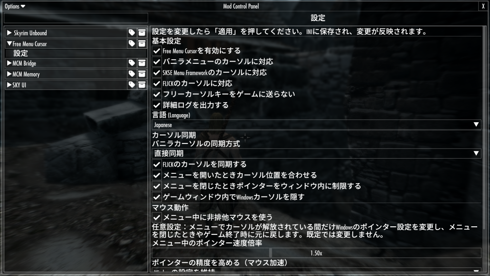

# Free Menu Cursor

[English README](README.md) · [ダウンロード（Releases）](https://github.com/BluishCat/free-menu-cursor/releases/latest)

Skyrim Special Edition／Anniversary Edition用のSKSEプラグインです。メニューのカーソルが出ている間は、Windowsのカーソルがゲームウィンドウの中に閉じ込められなくなります。Alt+Tabを使わずに、別のモニターや別のアプリ（ブラウザ、Wiki、Discordなど）へマウスを動かせます。

## スクリーンショット
SKSE Menu Frameworkの設定画面：



## 機能
- **バニラのメニュー**、**SKSE Menu Framework**、**FLICK**でカーソルを解放します。
- ゲーム内のカーソルをWindowsのカーソルに追従させるので、ゲームに戻ったときに位置がずれません。
- **フリーカーソルキー**（既定は右Ctrl）。押している間は、メニューを開いていなくてもカーソルを解放します。押したままウィンドウの外へ出すと、キーを離しても解放されたままになり、ゲーム画面をクリックすると元に戻ります。
- メニュー中だけポインター速度や加速を変えられます（任意・既定は無効。後述）。
- SKSE Menu Frameworkに設定ページがあります。表示は英語と日本語に対応しています（`sLanguage=auto|en|ja`）。INIを直接編集しても設定できます。

## 必要なもの
- お使いのゲームバージョンに合ったSKSE64
- [Address Library for SKSE Plugins](https://www.nexusmods.com/skyrimspecialedition/mods/32444)
- 任意：SKSE Menu Framework（設定ページとカーソル対応）、FLICK（カーソル対応）

## 対応状況
| ゲームバージョン | 状態 |
|---|---|
| SE 1.5.97 | 動作確認済み |
| AE 1.6.1170 | 動作確認済み |
| AE 1.7.104 | 動作確認済み |
| Skyrim VR | 非対応 |

- **SSE Display Tweaks**：メニューを開いている間のカーソル固定はこのMODが解除するので、`LockCursor`は今の設定のままで構いません。
- 入力処理をフックするほかのMOD（SKSE Menu Framework、Hotkey Atlasなど）とも併用できます。
- バニラのメニューを伴わずに表示されるImGuiのオーバーレイは、まだ検出できません。その場合はフリーカーソルキーを使ってください。

## Windowsのポインター設定（任意）
カーソルが解放されている間、ゲーム内のメニューカーソルはWindowsのカーソルに追従するので、動く速さはWindowsのポインター速度になります。`fMenuCursorSpeed`と`iMenuPointerPrecision`を使うと、メニュー中だけ速度と加速を変えられます。**どちらも既定では無効です。** 有効にした場合の動作：
- 変更はWindowsの設定には保存されません（`SPIF_UPDATEINIFILE`を使いません）。
- メニューを閉じたとき、ゲームがフォーカスを失ったとき、ゲームを終了したときに元へ戻します。
- ゲームがクラッシュした場合は、同梱の小さな補助プログラム`Free Menu Cursor Restore.exe`が元の値に戻します。これはこの2つの設定のどちらかを有効にしたときだけ起動します。次回起動時にも、戻し忘れがないか確認します。

## 同梱ファイル
```
SKSE/Plugins/Free Menu Cursor.dll
SKSE/Plugins/Free Menu Cursor.pdb                         （クラッシュログ用のシンボル）
SKSE/Plugins/Free Menu Cursor.ini
SKSE/Plugins/Free Menu Cursor/Free Menu Cursor Restore.exe
SKSE/Plugins/Free Menu Cursor/THIRD_PARTY_NOTICES.txt
```

## 不具合の報告
問題が起きたら、ゲームを起動し直す前に次のファイルを添付してください（ログは起動するたびに上書きされます）。
- `Documents\My Games\Skyrim Special Edition\SKSE\Free Menu Cursor.log`（先に`bDebugLog=1`にしてください）
- ゲームがクラッシュした場合は、Crash Loggerの`crash-*.log`

## 0.1.x（FreeMenuCursor）からの更新
古い`FreeMenuCursor.dll`を削除してください。設定を引き継ぐ場合は、`FreeMenuCursor.ini`を`Free Menu Cursor.ini`に名前を変えてください。

## ビルド
必要なもの：Visual Studio 2022（MSVC x64）、CMake 3.21以上、Ninja（VSに同梱）、[vcpkg](https://github.com/microsoft/vcpkg)

1. [CommonLibSSE-NG](https://github.com/alandtse/CommonLibSSE-NG)（`ng`ブランチ）をクローンし、そのフォルダーを環境変数`COMMONLIB_SSE_FOLDER`に設定します。
2. vcpkgのフォルダーを`VCPKG_ROOT`に設定します。
3. 「x64 Native Tools Command Prompt for VS 2022」で次を実行します。
   ```
   cmake --preset release
   cmake --build build/release
   ```
   `build/release/`に`Free Menu Cursor.dll`と`Free Menu Cursor Restore.exe`ができます。

テスト（ゲーム不要）：`tests
un_ui_strings_test.bat`、`tests
un_settings_test.bat`

## ライセンス
GPL-3.0-or-later です（このプラグインが静的リンクしているCommonLibSSE-NGのライセンスに合わせる必要があるため）。`LICENSE`と`THIRD_PARTY_NOTICES.txt`を参照してください。
